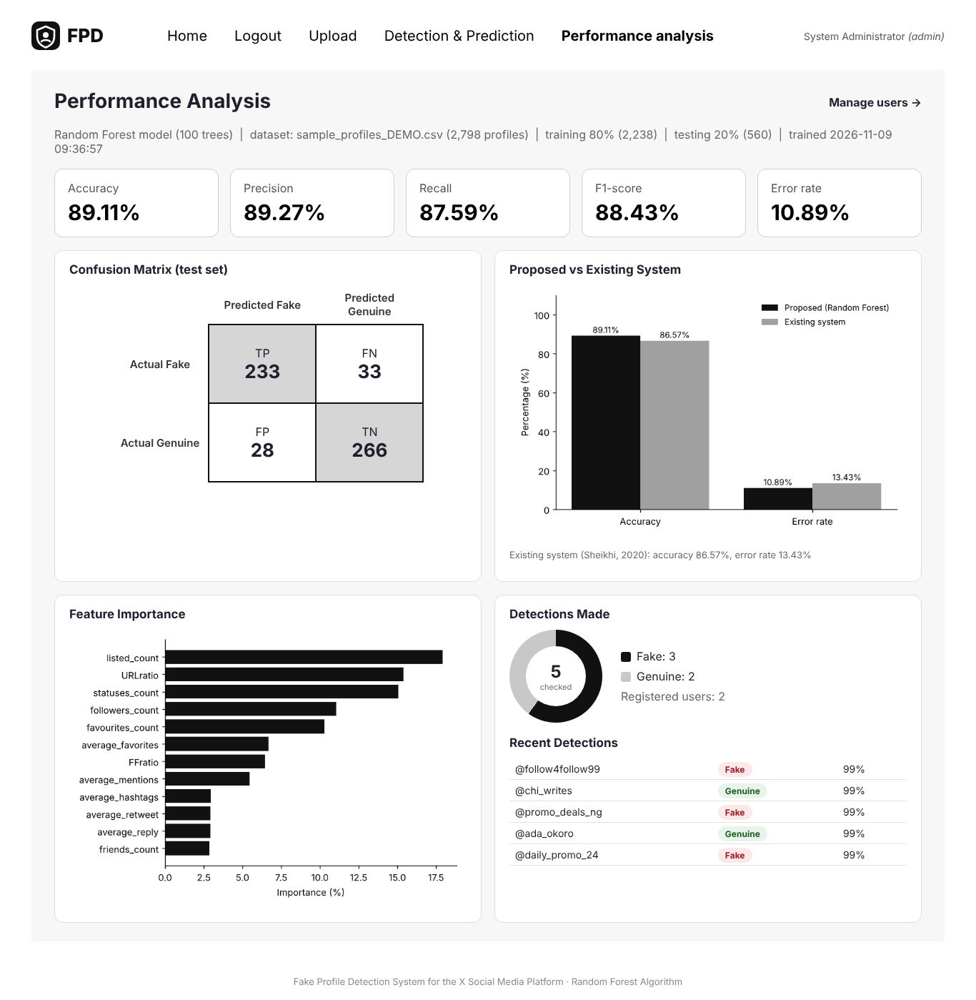
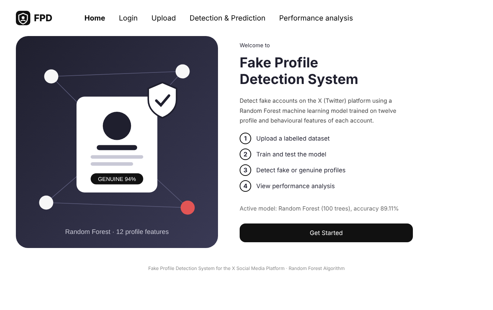
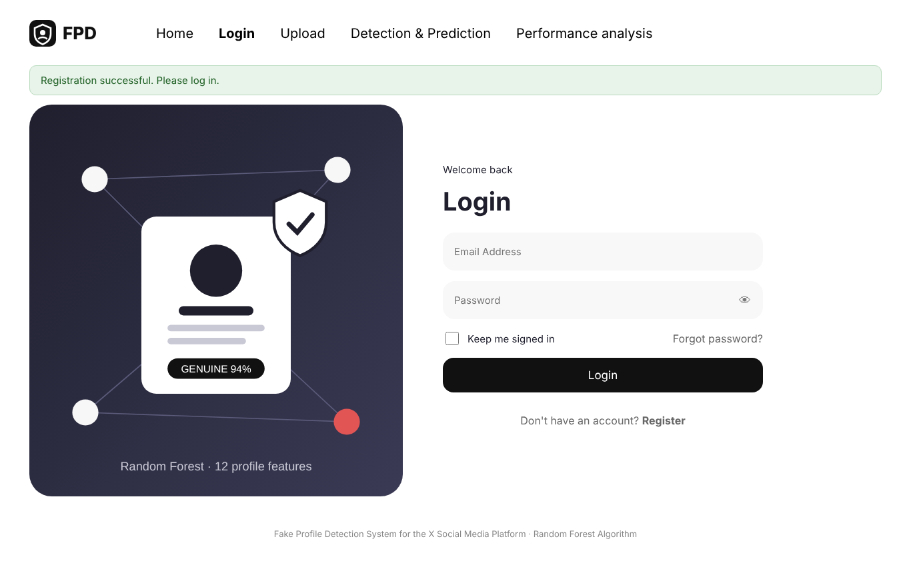
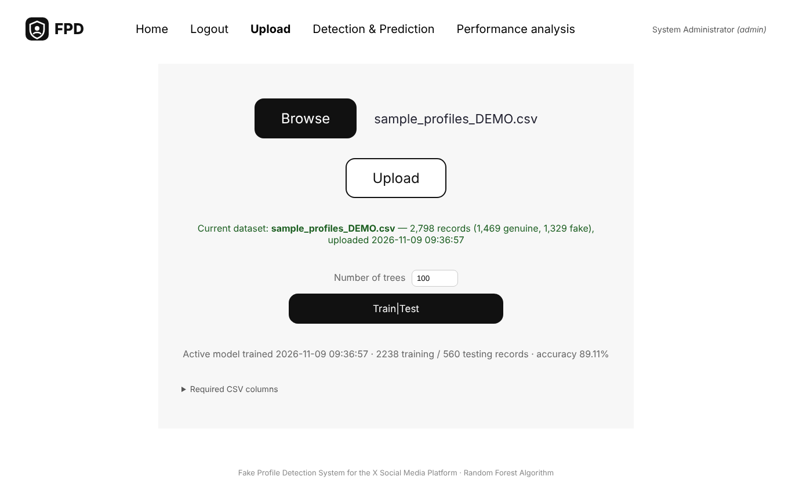
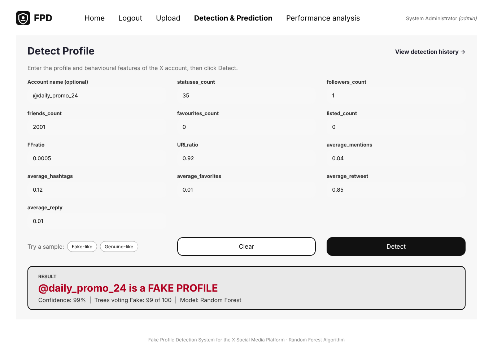
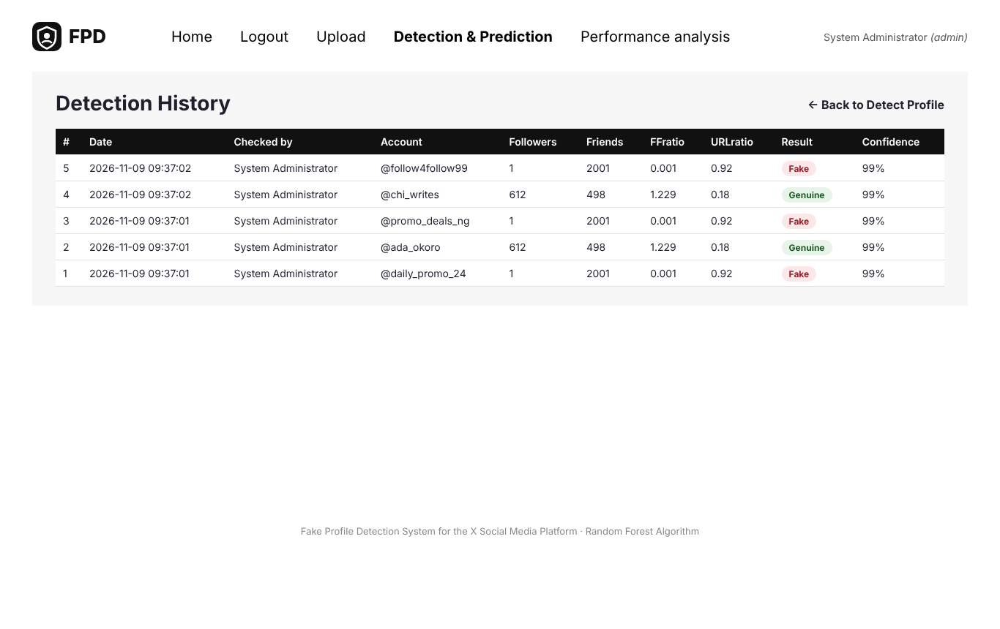
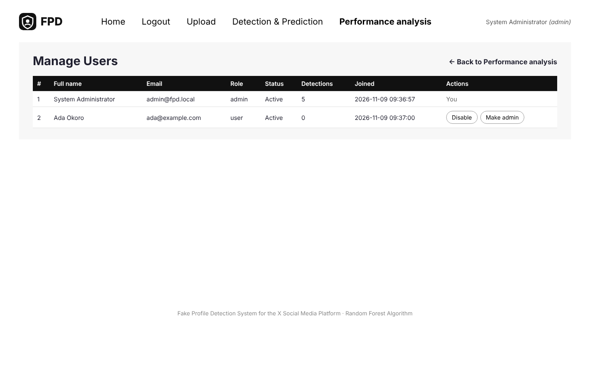

# Fake Profile Detection System for the X Social Media Platform Using Random Forest Algorithm

A web application that detects **fake accounts on X (formerly Twitter)** with a **Random Forest** machine learning model
trained on twelve profile and behavioural features. It provides user registration and login, dataset upload,
model training and testing, profile detection with a confidence score, detection history and a performance
analysis dashboard.



## Features

| Page | What it does |
|---|---|
| **Home** | Introduces the system and the four steps of using it |
| **Login / Register** | Secure accounts (hashed passwords, sessions, lock after 5 failed logins) |
| **Upload** *(administrator)* | Browse and upload a labelled CSV dataset, then click **Train\|Test** |
| **Detection & Prediction** | Enter the 12 features of an account and click **Detect** → *Fake* or *Genuine* with confidence (share of trees that voted) |
| **Performance analysis** | Dashboard: accuracy, precision, recall, F1-score, error rate, confusion matrix, comparison with the existing system, feature importance, detection statistics |
| **Detection history / Manage users** | Stored detections; administrator can enable, disable or promote users |

## Features used by the model

`statuses_count`, `followers_count`, `friends_count`, `favourites_count`, `listed_count`, `FFratio`,
`URLratio`, `average_mentions`, `average_hashtags`, `average_favorites`, `average_retweet`, `average_reply`
and the target `label` (1 = fake, 0 = genuine). The data is split 80% training / 20% testing (stratified)
and a `RandomForestClassifier` (100 trees, Gini index, √12 features per split) is trained.

## Quick start

**Requirements:** Python 3.10 or later (tick *Add Python to PATH* when installing on Windows).

### Windows (one click)
Double-click **`run_windows.bat`**. It installs the packages, creates the administrator account,
trains the first model and opens <http://127.0.0.1:5000>.

### Any system (manual)
```bash
git clone https://github.com/<your-username>/fake-profile-detection.git
cd fake-profile-detection
python -m venv venv
venv\Scripts\activate            # Windows   (Linux/macOS: source venv/bin/activate)
pip install -r requirements.txt
python seed.py --email admin@fpd.local --password Admin12345 --dataset data/sample_profiles_DEMO.csv
python app.py
```
Open <http://127.0.0.1:5000> and log in with **admin@fpd.local / Admin12345**
(change the password for real use: run `seed.py` again with a new `--password`).

## Using the real dataset

`data/sample_profiles_DEMO.csv` is **synthetic demonstration data** generated by
`scripts/make_sample_data.py` so the software can be run immediately. **Its results are not research results.**
To reproduce the study, log in as administrator, open **Upload**, choose the real labelled dataset
(2,798 X accounts: 1,469 genuine, 1,329 fake) and click **Train|Test**, or run:
```bash
python seed.py --email admin@fpd.local --password Admin12345 --dataset data/your_real_dataset.csv
```
The terminal and the dashboard then show the real accuracy, precision, recall, F1-score and confusion matrix.

## Running the tests
```bash
python -m pytest -q
```
The tests cover registration, login, access control, CSRF protection, upload validation, training,
detection (fake and genuine), input validation, history, the dashboard and escaping of script input.

## Project structure
```
app.py                 Flask application: routes for all pages
ml_engine.py           Pre-processing, Random Forest training/testing, charts, detection
database.py            SQLite tables: users, datasets, trained_models, detections
seed.py                Creates the administrator and trains the first model
templates/             HTML pages (Home, Login, Register, Upload, Detect, History, Performance, Users)
static/css, static/img Stylesheet and logo
data/                  Demonstration dataset
scripts/               Demo data generator
tests/                 Automated tests
docs/screenshots/      Screenshots of every page
```

## Technology
Python 3 · Flask · scikit-learn · pandas · NumPy · joblib · Matplotlib · SQLite · HTML5/CSS3

## Screenshots
| | |
|---|---|
|  |  |
|  |  |
|  |  |

## Author
Gift Friday Barisua — research project: *A Fake Profile Detection System for the X Social Media Platform Using Random Forest Algorithm*.
